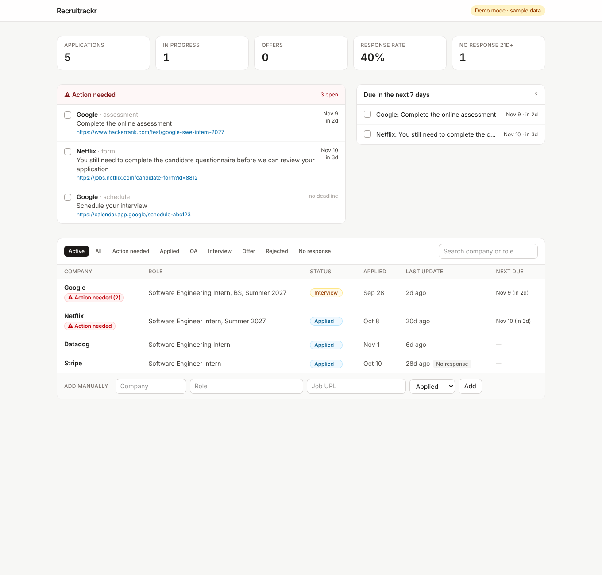
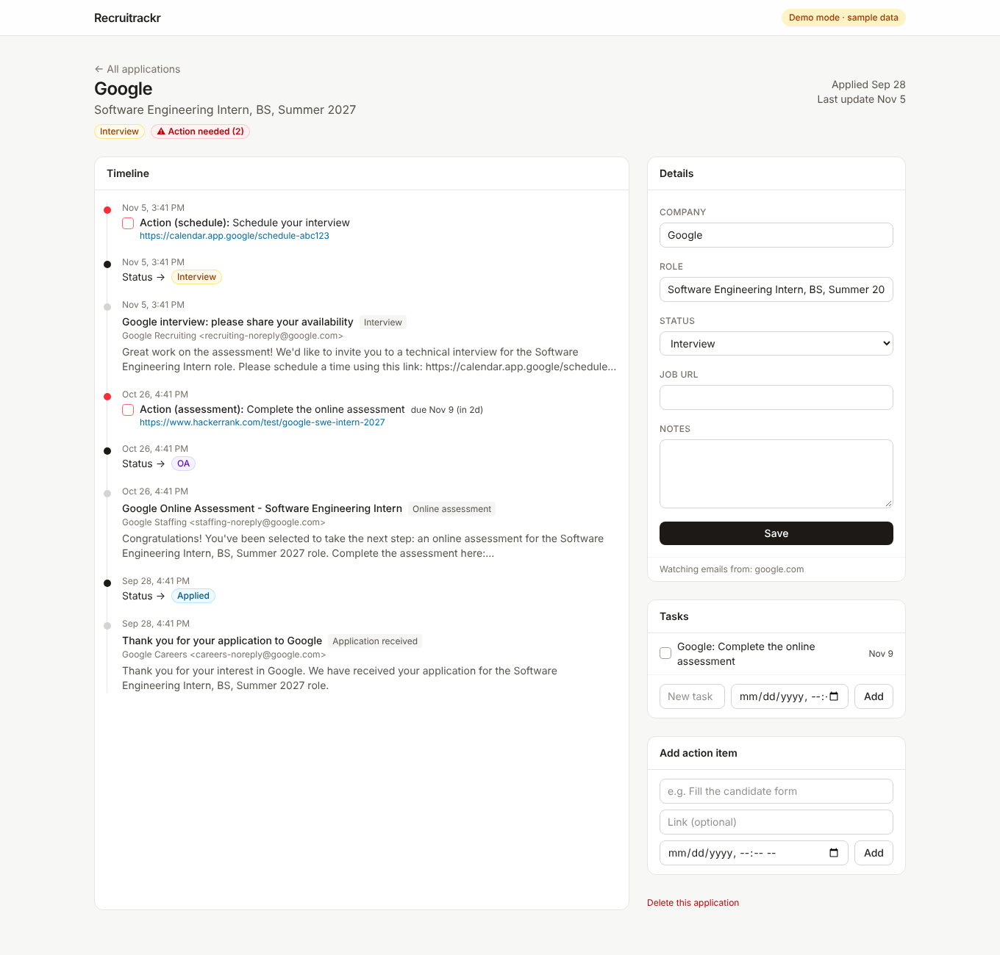
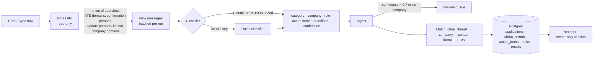

# Recruitrackr

**Your recruiting pipeline, built from your inbox.** Recruitrackr reads your Gmail, finds every application confirmation, assessment invite, interview request, rejection and offer, and keeps one up-to-date record per application, so nothing slips through. That includes the easy-to-miss follow-ups like *"if you applied, you still need to complete this form before we review your application."*



## What it does

- **Finds every application.** It pulls "thank you for applying" emails from *any* company, not just job-application systems like Greenhouse, Workday and Lever, plus OA platforms (HackerRank, CodeSignal, HireVue…).
- **Tracks status over time.** Applied → OA → Interview → Offer / Rejected. Status only moves forward, each change is stamped with the email that caused it, and you can override it by hand.
- **Flags anything that needs you.** Forms, documents, scheduling links and assessments become **Action needed** items with the exact link and deadline, pinned to the top of the home page.
- **Builds your to-do list.** Deadlines and interview times become tasks, and the home page shows everything due in the next 7 days.
- **Spots silence.** Applications with no update in 21+ days are marked **No response**.
- **Learns company domains.** Once it sees `netflix.com` on a Netflix application, it pulls every later email from that domain.
- **Lets you confirm unclear emails.** Emails it isn't sure about wait in a **Review** queue for you to confirm or correct.
- **Syncs on a schedule** (daily on Vercel's free plan, or every 3 hours with the included GitHub Action), plus a **Sync now** button.



## How it works



**Design choices:**
- **Classification** (`src/lib/classify.ts`): Claude returns strict JSON that's validated with Zod and retried once if invalid. A regex-based rules classifier is the fallback, so the app works without an API key and tests don't need the network.
- **Matching** (`src/lib/ingest.ts`): an email first joins its Gmail thread's application, then the normalized company name, then a known sender domain. Same company with a different role means a new application. Each email is applied in a single transaction.
- **Status rules**: status only moves forward, and offer/rejected are terminal. Every change is recorded as a timeline event.
- **Serverless-friendly sync** (`src/lib/sync.ts`): it processes at most `MAX_EMAILS_PER_SYNC` emails per run and only advances the sync window once a run has caught up, so a big first sync spreads across several runs.
- **Security** (`src/lib/secure.ts`, `src/lib/auth.ts`):
  - Only the Google account in `ALLOWED_EMAIL` can sign in.
  - Sessions are HMAC-signed cookies, checked in every data read and server action.
  - Gmail tokens are encrypted at rest with AES-256-GCM.
  - The cron endpoint requires a bearer secret.
  - Gmail access is read-only, and only subject, sender, date and a snippet are stored.
- **One codebase, two databases** (`src/lib/db.ts`): real Postgres when `DATABASE_URL` is set, embedded Postgres (PGlite) otherwise, so local dev and tests need zero setup.

## Deploy it (free: Vercel + Neon, about 20 minutes)

### 1. Database
Create a free Postgres database at <https://neon.tech> and copy the **pooled** connection string. Tables are created automatically on first run.

### 2. Google Cloud
1. Go to <https://console.cloud.google.com/> and create a project.
2. **APIs & Services → Library →** enable the **Gmail API**.
3. **OAuth consent screen:** choose *External*, add the scope `.../auth/gmail.readonly`, add your Gmail under **Test users**, and leave it in **Testing**.
4. **Credentials → Create OAuth client ID → Web application.** Add both redirect URIs:
   - `http://localhost:3000/api/auth/callback`
   - `https://<your-app>.vercel.app/api/auth/callback` (add this after step 3 gives you the URL)

### 3. Vercel
1. Push this repo to GitHub. Import it at <https://vercel.com/new>.
2. Add environment variables (see `.env.example`): `DATABASE_URL`, `GOOGLE_CLIENT_ID`, `GOOGLE_CLIENT_SECRET`, `ALLOWED_EMAIL`, `SESSION_SECRET`, `CRON_SECRET`, `ANTHROPIC_API_KEY`.
3. Deploy. Open the site, click **Sign in with Google**, then **Sync now**.

The included `vercel.json` runs a sync every day at 12:00 UTC. For more frequent syncs, add `APP_URL` and `CRON_SECRET` as GitHub repository secrets, and `.github/workflows/scheduled-sync.yml` will sync every 3 hours.

> Google apps in **Testing** mode issue tokens that expire after about 7 days. When sync says access expired, sign out and sign in again.

## Run locally
```bash
npm install
cp .env.example .env.local   # fill in Google credentials (+ Anthropic key)
npm run dev                  # http://localhost:3000, uses an embedded database in ./data
```

**Try it without Gmail:**
```bash
npm run demo       # loads sample emails into data/demo-pglite
npm run dev:demo   # opens the app on that data (no sign-in, sync disabled)
```

## Scripts
| Command | What it does |
|---|---|
| `npm run dev` | Start the app |
| `npm test` | Unit, pipeline and security tests (Vitest, embedded Postgres; set `TEST_DATABASE_URL` to use a real server) |
| `npm run typecheck` / `npm run lint` | Type checking and linting |
| `npm run demo` / `npm run dev:demo` | Sample data and preview mode |

## Limits
- It only sees what reaches your inbox. Some companies post updates only in their candidate portal (Workday especially), so check the portal for long-silent applications.
- It's built for one user per deployment.

## Roadmap
- [ ] Kanban view
- [ ] Network matcher: import a LinkedIn connections CSV and see your contacts at each company
- [ ] Resume tailor service: attach a tailored resume version to each application
- [ ] Multi-user accounts

## Stack
Next.js 16 (App Router, Server Actions) · TypeScript · Tailwind CSS 4 · Postgres (postgres.js / PGlite) · Gmail API · Anthropic API · Zod · Vitest · Vercel
